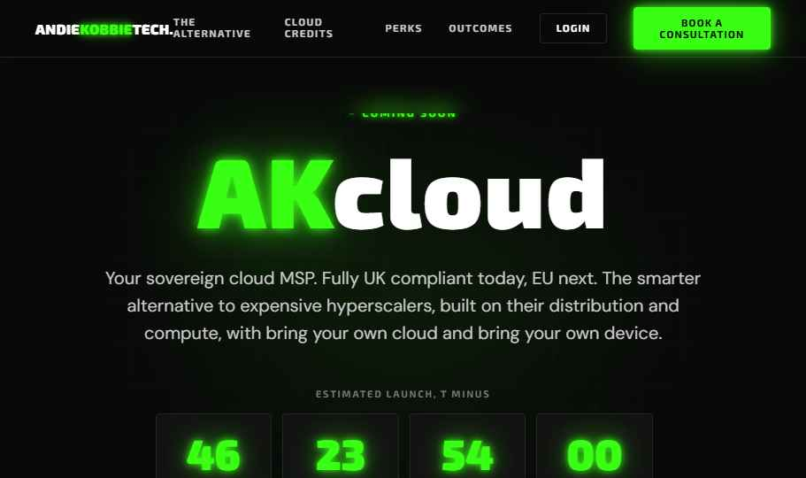

<p align="center">
  
</p>

<h1 align="center">AKTOps</h1>

<p align="center">
  <strong>IT Operations, Cloud Infrastructure & DevSecOps: Service Website</strong><br>
  <em>Static service website with a documented path to Elestio-managed Odoo Community on OCI BYOVM</em>
</p>

<p align="center">
  <a href="#what-i-built">What I Built</a> •
  <a href="#live-demo">Live Demo</a> •
  <a href="#screenshots">Screenshots</a> •
  <a href="#technical-approach">Technical Approach</a> •
  <a href="#architecture">Architecture</a> •
  <a href="docs/architecture/odoo-community-oci-booking.md">Odoo Architecture</a> •
  <a href="docs/implementation/elestio-byovm-oci-runbook.md">Elestio BYOVM Runbook</a> •
  <a href="docs/implementation/odoo-community-oci-booking-plan.md">Implementation Plan</a> •
  <a href="LICENSING.md">Licensing</a> •
  <a href="SECURITY_REVIEW.md">Security Review</a>
</p>

---

## What I Built

A service website and client-acquisition pipeline for AKTOps, covering IT operations, cloud infrastructure and DevSecOps. This README reflects the new service identity; the existing deployment address and repository slug remain legacy identifiers pending a later migration.

| Feature | Implementation |
|---|---|
| **Animated Landing Page** | Custom CSS animations: phosphorescent circuit board aesthetic, AK zoom-in intro, typewriter effects |
| **Interactive Glossary** | Hover/tap tooltips explaining cloud terminology (MSP, sovereign, hyperscaler, etc.): accessibility-first |
| **Email Waitlist** | Netlify Forms with webhook processing → Resend email notifications → Slack/Discord alerts |
| **Appointment Booking** | Current site opens a configured external booking URL; migration to Odoo Community 19 via Elestio BYOVM on OCI is planned and documented |
| **Admin Panel** | Disabled and removed during security remediation; replacement requires server-side authentication |
| **Security** | Legacy admin and booking endpoints removed; remediation merged and deployment workflow successful |

---

## Live Demo

**Existing deployment URL:** [akcloud.netlify.app](https://akcloud.netlify.app) (legacy AKCloud deployment hostname; domain and deployment branding will be updated separately)

---

## Screenshots

### Landing Page: Hero View
<p align="center">
  
</p>

*Full landing page with nav, countdown timer, and "Coming Soon" badge. Pure HTML/CSS: no JavaScript frameworks.*

### Interactive Glossary Tooltips
<p align="center">
  
</p>

*Hover any underlined term to see a plain-English explanation. Built for non-technical founders evaluating cloud services. Accessibility: works on touch devices, respects `prefers-reduced-motion`.*

---

## The Problem It Solves

The service needed a professional landing page that:

1. **Captures leads** without depending on third-party form services
2. **Provides a route to discovery consultations** through a separately hosted booking service
3. **Keeps client data sovereign**: not trapped in SaaS platforms
4. **Works without JavaScript frameworks** or build pipelines

**Current state:** The static site and lead-notification function are in place. The Elestio-managed Odoo Community 19 service on an AKTOps-owned OCI BYOVM VM is a planned integration and is not yet represented as a live production booking system. Legacy admin and XML-RPC endpoints have been removed in the merged remediation. GitHub Actions build/deploy completed successfully; live route smoke tests and environment-variable review remain outstanding.

---

## Technical Approach

| Layer | Stack |
|---|---|
| Frontend | Vanilla HTML/CSS/JS: no build step, no frameworks |
| Hosting | Netlify (static + serverless) |
| Forms | Netlify Forms with webhook processing |
| Backend | Netlify Functions (Node.js) |
| Booking | Planned: Odoo Community on OCI with an independently authored AKTOps booking addon |
| Email | Resend API via serverless functions |
| Configuration | Netlify environment variables for public configuration; Odoo credentials remain server-side |

---

## Architecture

```
Visitor / staff
  |
  v
AKTOps website (Netlify static HTML/CSS/JS)
  | HTTPS booking link
  v
booking.aktops.co.uk
  |
  v
Elestio-managed Odoo Community 19 service
  | BYOVM management connection
  v
OCI Compute VM (AKTOps tenancy)
  |                         |
  |                         +--> PostgreSQL (private only)
  |
  +--> Odoo filestore (persistent)
  +--> independently authored AKTOps booking addon (planned)
```

The booking service is a separate application running on AKTOps-owned OCI infrastructure and managed through Elestio BYOVM. The current website booking link still points to the legacy Odoo Online URL until the new service is deployed and verified.

---

## What This Demonstrates

- **Frontend ownership**: Static AKTOps website and Netlify delivery
- **No-code to code bridge**: Started with drag-and-drop, identified limits, built custom solution
- **Architecture direction**: Odoo Community 19 is planned through Elestio BYOVM on AKTOps-owned OCI infrastructure
- **B2B delivery mindset**: Every decision optimized for client trust (security headers, transparent booking flow)
- **Integration boundary**: Public website remains separate from the booking system and its database

---

## Running Locally

```powershell
npm install -g netlify-cli
netlify dev
# Opens at http://localhost:8888
```

---

## Skills Used

`Netlify` · `Netlify Functions` · `Vanilla JavaScript` · `HTML/CSS` · `Odoo Community (planned)` · `OCI (planned)` · `DevSecOps` · `Client-Facing Delivery`

---

<p align="center">
  <strong>Built by Andie Kobbie</strong><br>
  <em>AI Solutions Consultant / Automation Engineer</em><br>
  <a href="https://github.com/andiekobbietks">GitHub</a>
</p>
