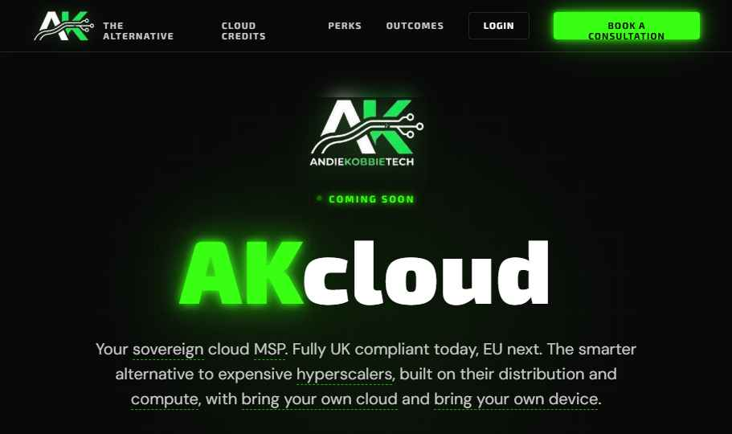
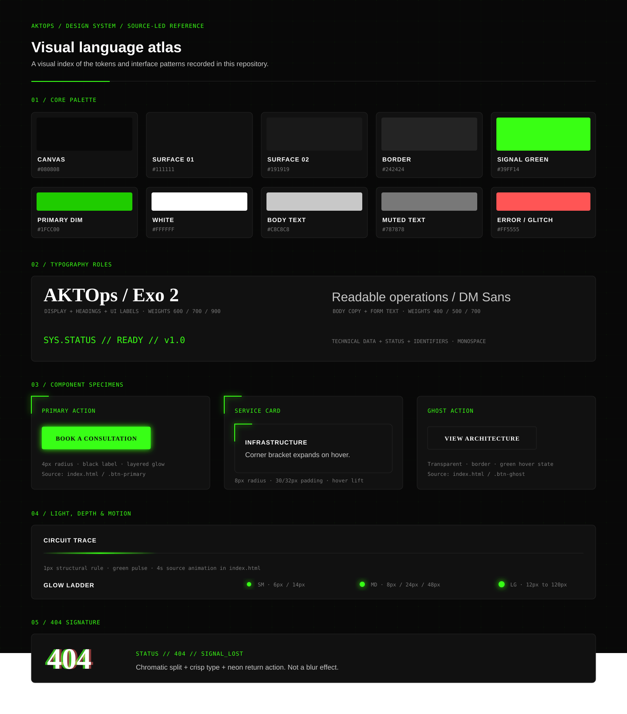

<p align="center">
  
</p>

<h1 align="center">AKTOps</h1>

<p align="center">
  <strong>IT Operations, Cloud Infrastructure & DevSecOps: Service Website</strong><br>
  <em>Static service website with a documented path to Elestio-managed Odoo Community on OCI BYOVM</em>
</p>

<p align="center">
  <a href="#what-i-built">What I Built</a> •
  <a href="#live-demo">Live Demo</a> •
  <a href="#screenshots">Screenshots</a> •
  <a href="#design-system-showcase">Design System</a> •
  <a href="#technical-approach">Technical Approach</a> •
  <a href="#architecture">Architecture</a> •
  <a href="docs/architecture/odoo-community-oci-booking.md">Odoo Architecture</a> •
  <a href="docs/implementation/elestio-byovm-oci-runbook.md">Elestio BYOVM Runbook</a> •
  <a href="docs/implementation/website-onboarding.md">Website Onboarding</a> •
  <a href="docs/implementation/decap-cms.md">Decap CMS Guide</a> •
  <a href="DESIGN.md">Design Contract</a> •
  <a href="docs/design-system.md">Design System Guide</a> •
  <a href="docs/design/token-reference.md">Tokens & Components</a> •
  <a href="docs/design/pixel-sampling.md">Pixel Sampling</a> •
  <a href="docs/design/stitch-workflow.md">Google Stitch Workflow</a> •
  <a href="docs/implementation/cli-operations-runbook.md">CLI Operations Runbook</a> •
  <a href="docs/implementation/odoo-community-oci-booking-plan.md">Implementation Plan</a> •
  <a href="LICENSING.md">Licensing</a> •
  <a href="SECURITY_REVIEW.md">Security Review</a>
</p>

---

## What I Built

A service website and client-acquisition pipeline for AKTOps, covering IT operations, cloud infrastructure and DevSecOps. This README reflects the new service identity; the existing deployment address and repository slug remain legacy identifiers pending a later migration.

| Feature | Implementation |
|---|---|
| **Animated Landing Page** | Custom CSS animations: phosphorescent circuit board aesthetic, AK zoom-in intro, typewriter effects |
| **Interactive Glossary** | Hover/tap tooltips explaining cloud terminology (MSP, sovereign, hyperscaler, etc.): accessibility-first |
| **Onboarding Form** | Netlify Forms consultation request with name, work email, organisation, service area and optional context |
| **Appointment Booking** | Uses a validated HTTPS `BOOKING_URL` only when configured; otherwise offers the onboarding request form. Odoo Community 19 via Elestio BYOVM on OCI remains planned |
| **Content Management** | Decap CMS at `/admin/`, GitHub-backed editorial workflow, editable homepage copy and Markdown insights; OAuth setup required |
| **Security** | Legacy admin and booking endpoints removed; remediation merged and deployment workflow successful |

---

## Live Demo

**Existing deployment URL:** [akcloud.netlify.app](https://akcloud.netlify.app) (legacy AKCloud deployment hostname; domain and deployment branding will be updated separately)

---

## Screenshots

### Landing Page: Hero View
<p align="center">
  
</p>

*Landing page with responsive navigation, early-access status and a consultation/onboarding call to action. Pure HTML/CSS/JS without a frontend framework.*

### Interactive Glossary Tooltips
<p align="center">
  
</p>

*Hover any underlined term to see a plain-English explanation. Built for non-technical founders evaluating cloud services. Accessibility: works on touch devices, respects `prefers-reduced-motion`.*

---

## Design System Showcase

The interface is built around a phosphorescent circuit-board visual language: near-black surfaces, signal-green interaction, geometric display type, monospace system labels, controlled optical glow and a distinctive chromatic 404 state.

<p align="center">
  
</p>

The atlas is a visual index of the **source-defined** design tokens and components. It is paired with a deeper reference so design exploration in Google Stitch and implementation/review in OpenCode use the same evidence.

| Design reference | What it contains |
|---|---|
| [Design system guide](docs/design-system.md) | Design intent, hierarchy, glow/blur distinction, Stitch workflow and change control |
| [Token and component reference](docs/design/token-reference.md) | Colour, typography, spacing, shape, motion, responsive rules and component inventory |
| [Pixel sampling protocol](docs/design/pixel-sampling.md) | Reproducible raster sampling method, image-format checks and evidence recording |
| [Google Stitch workflow](docs/design/stitch-workflow.md) | Reusable visual brief, export hand-off and OpenCode implementation process |
| [OpenCode design skill](.opencode/skills/aktops-design/SKILL.md) | Repository-aware design implementation instructions |
| [Canonical design contract](DESIGN.md) | Original design intent and token specification |

**Sampling note:** the atlas displays exact values declared in the design contract and CSS. It is not presented as a screenshot-derived pixel histogram. The two existing screenshot payloads currently have JPEG signatures despite their `.png` filenames; the sampling guide records this and defines the follow-up checks.

---

## The Problem It Solves

The service needed a professional landing page that:

1. **Captures onboarding requests** through Netlify Forms
2. **Provides a route to discovery consultations** through a separately hosted booking service
3. **Keeps client data sovereign**: not trapped in SaaS platforms
4. **Works without JavaScript frameworks** or build pipelines

**Current state:** The static site presents an onboarding request form until an explicit HTTPS booking URL is configured. Netlify Forms must be enabled and a live submission tested in the Netlify dashboard. The Elestio-managed Odoo Community 19 service on an AKTOps-owned OCI BYOVM VM is planned, not provisioned. The page does not pretend to save failed submissions locally or offer a fake client login. Legacy admin and XML-RPC endpoints have been removed in the merged remediation. GitHub Actions build/deploy completed successfully; live route smoke tests and environment-variable review remain outstanding.

---

## Technical Approach

| Layer | Stack |
|---|---|
| Frontend | Vanilla HTML/CSS/JS: no build step, no frameworks |
| Hosting | Netlify (static + serverless) |
| Forms | Netlify Forms consultation intake (dashboard notifications require configuration) |
| Backend | Netlify Functions (Node.js) |
| Booking | Planned: Odoo Community 19 via Elestio BYOVM on OCI with an independently authored AKTOps booking addon |
| Email | Resend API via serverless functions |
| Configuration | Netlify environment variables for public configuration; Odoo credentials remain server-side |

---

## Architecture

```
Visitor / staff
  |
  v
AKTOps website (Netlify static HTML/CSS/JS)
  | HTTPS booking link
  v
booking.aktops.co.uk
  |
  v
Elestio-managed Odoo Community 19 service
  | BYOVM management connection
  v
OCI Compute VM (AKTOps tenancy)
  |                         |
  |                         +--> PostgreSQL (private only)
  |
  +--> Odoo filestore (persistent)
  +--> independently authored AKTOps booking addon (planned)
```

The booking service is a separate application running on AKTOps-owned OCI infrastructure and managed through Elestio BYOVM. Until `BOOKING_URL` is set in Netlify after Odoo deployment and acceptance testing, the website directs visitors to the onboarding request form. No Odoo tenant URL is hard-coded in the frontend.

---

## What This Demonstrates

- **Frontend ownership**: Static AKTOps website and Netlify delivery
- **No-code to code bridge**: Started with drag-and-drop, identified limits, built custom solution
- **Architecture direction**: Odoo Community 19 is planned through Elestio BYOVM on AKTOps-owned OCI infrastructure
- **B2B delivery mindset**: Every decision optimized for client trust (security headers, transparent booking flow)
- **Integration boundary**: Public website remains separate from the booking system and its database

---

## Running Locally

```powershell
npm install -g netlify-cli
netlify dev
# Opens at http://localhost:8888
```

---

## Skills Used

`Netlify` · `Netlify Functions` · `Vanilla JavaScript` · `HTML/CSS` · `Netlify Forms` · `Odoo Community (planned)` · `OCI (planned)` · `DevSecOps` · `Client-Facing Delivery`

---

<p align="center">
  <strong>Built by Andie Kobbie</strong><br>
  <em>AI Solutions Consultant / Automation Engineer</em><br>
  <a href="https://github.com/andiekobbietks">GitHub</a>
</p>
