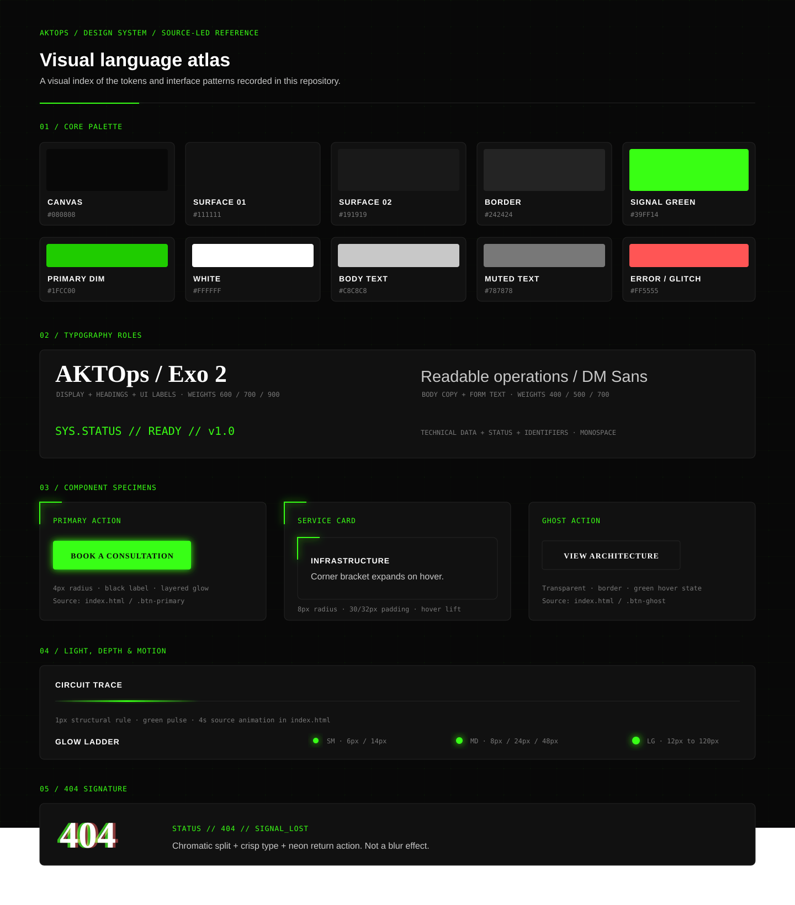

# AKTOps visual system

**Status:** documented from the current website source; tokens are catalogued but not yet extracted into shared CSS variables.

This document records the existing visual language so design work in Google Stitch and implementation work in OpenCode converge on the same product. It is not permission to redesign the brand or replace working UI.

## 1. Design intent

AKTOps presents technical operations as calm, precise, observable infrastructure. The interface combines a near-black canvas, high-energy signal green, restrained red error accents, geometric display typography and monospace operational labels.

The visual identity should feel:
- Technical and operational, not generic cyberpunk.
- High-contrast but readable.
- Deliberate: glow indicates focus, activity or emphasis rather than decorating every element.
- Consistent across the landing page, onboarding, booking hand-off, CMS-managed content, empty states and errors.

## 2. Source-of-truth hierarchy

When sources disagree, use this order:

1. Existing production UI and its current CSS, unless a verified defect is being corrected.
2. The root `DESIGN.md` as the canonical intended design contract.
3. The detailed evidence-led inventory in [token-reference.md](design/token-reference.md).
4. Approved Google Stitch screens and annotations for the specific task.
5. New proposals explicitly labelled as proposals.

Do not infer a new brand palette from a single screenshot. Do not silently replace existing copy, assets, layout or interaction behaviour. `uploads/DESIGN.md` is a near-duplicate CMS/upload copy, not the canonical design contract.

## 3. Current visual tokens observed in source

These are observed values, not a newly invented palette. They currently appear as literals in `index.html`, `404.html` and the root `DESIGN.md`; they have not yet been centralised in a token file.

| Token | Current value | Role |
|---|---|---|
| Canvas | `#080808` | Main page background |
| Surface | `#111111` | Cards, modals and raised panels |
| Surface elevated | `#191919` | Tooltip / secondary surface |
| Border | `#242424` | Dividers and component outlines |
| Signal green | `#39FF14` | Primary accent, actions, active states |
| Signal dim | `#1FCC00` | Defined pressed/active variant |
| Signal tint | `rgba(57,255,20,0.12)` | Subtle tinted state |
| Text primary | `#FFFFFF` | Headings and high-emphasis text |
| Text body | `#C8C8C8` | Main readable copy |
| Text muted | `#787878` | Supporting copy |
| Text subdued | `#3A3A3A` | Metadata and placeholders |
| Error accent | `#FF5555` | 404 glitch/chromatic offset |

### Typography

| Role | Typeface | Current usage |
|---|---|---|
| Display / headings | Exo 2 | Heavy headings, buttons, labels |
| Body / reading | DM Sans | Paragraphs, forms, navigation support |
| Operational / metadata | JetBrains Mono | Status labels, technical metadata, system messages |

Current source loads these from Google Fonts. Preserve the family roles and existing weights unless a deliberate, tested change is approved.

## 4. Chromatic diffusion, glow and depth

The brand treatment is not simply "blur everything". It is a layered optical effect built from colour, opacity, shadow and selective backdrop filtering.

### Techniques currently present

- **Neon halo:** layered `text-shadow` and `box-shadow` using signal green at different blur radii and opacities.
- **Chromatic split:** the 404 heading uses green and red pseudo-element copies, offset horizontally with `mix-blend-mode: screen`.
- **Diffused illumination:** large, low-opacity green shadow layers create a soft colour field around primary actions and highlighted components.
- **Frosted background:** the landing page navigation uses a translucent dark background with `backdrop-filter: blur(12px)`; the booking overlay uses `backdrop-filter: blur(6px)`.
- **Depth separation:** dark surface layers, thin borders and restrained shadows distinguish cards, tooltips and overlays.

### Usage rules

1. Keep the base canvas dark and surfaces distinguishable from it.
2. Use signal green for meaningful interaction, focus, status and primary calls to action.
3. Use a small, medium and large glow layer rather than one hard neon outline.
4. Diffusion must sit behind readable text; never reduce text contrast to make the glow stronger.
5. Reserve chromatic red/green splitting for deliberate glitch or signal-loss moments, not normal body text.
6. Use backdrop blur selectively on overlays and translucent navigation. Do not apply it to every card.
7. Keep glow intensity lower on dense content, forms and long reading surfaces.
8. Provide a non-motion and reduced-transparency fallback where appropriate.
9. Do not introduce arbitrary extra accent colours without documenting their semantic role.

### Important source distinction

The current `404.html` uses text shadows, layered button box shadows and green/red chromatic offsets. It does **not** currently declare `filter: blur()` or `backdrop-filter`. The actual backdrop blur is in the main landing page navigation and booking overlay. Describe the 404 as a glow/chromatic treatment, not as a frosted-glass implementation.

## 5. Component language

- **Primary action:** signal-green fill, near-black text, Exo 2 uppercase label, controlled green halo.
- **Secondary action:** transparent/dark fill, subtle border; green border/glow on hover or focus.
- **Cards:** dark raised surface, thin border, restrained corner signal detail and subtle lift on hover.
- **Status labels:** JetBrains Mono, uppercase or technical notation, letter-spaced, signal green when active.
- **Errors:** concise explanation, clear recovery action and no blame; the 404's "Return to Base" is the reference voice.
- **Forms:** dark fields with visible borders; green focus indicator must remain obvious without relying on glow alone.

The full component inventory, including navigation, cards, perk cards, glossary terms/tooltips, booking modal, form controls, countdown, status shimmer and 404 state, is in [token-reference.md](design/token-reference.md).

## 6. Visual atlas and pixel sampling

The [visual atlas](design/visual-atlas.svg) makes the source-defined palette, typography roles, component specimens, glow ladder, circuit trace and 404 treatment visible in one zoomable reference.

The atlas is deliberately labelled as a source-token visualisation. It is not a screenshot-derived colour histogram. For reproducible raster measurements, use the [pixel sampling protocol](design/pixel-sampling.md). That protocol records file signatures, hashes, dimensions, sample coordinates and colour values, and distinguishes flat token colours from glow/compositing artefacts.

The current repository screenshot files named `screenshots/hero.png` and `screenshots/tip.png` have JPEG signatures despite their `.png` extensions. Both are AKCloud-era captures with the previous wordmark/copy, not screenshots of the current AKTOps rebrand. Treat their format and branding age as asset-provenance debt and verify all references before any rename or replacement.

## 7. Accessibility and responsive constraints

- Maintain WCAG AA contrast for normal text wherever possible; do not assume neon green on black is sufficient at every font size and weight. Verify actual foreground/background pairs.
- Focus states must be visible for keyboard users and not depend only on hover.
- Respect `prefers-reduced-motion`; avoid essential information being conveyed only by animation or glitch.
- Check mobile layouts, touch targets, zoom and text wrapping.
- Do not use hover-only interactions for essential controls.
- Avoid blur effects that make underlying content difficult to understand or increase motion sensitivity.

The token reference records current breakpoints and animation names/durations observed in `index.html`.

## 8. Google Stitch → OpenCode workflow

Google Stitch is the visual exploration and screen-design environment. OpenCode is the repository-aware implementation and verification agent. Treat the Stitch output as a design proposal, not as automatically production-ready code.

### Before designing in Stitch

Give Stitch:
- The relevant current screenshot(s) and page context.
- The token reference and visual atlas.
- The type roles and component rules.
- The user journey and the job the screen must accomplish.
- Explicit "preserve" constraints (brand, copy, routes, form behaviour, accessibility).

Ask Stitch to explore the requested screen or state only. Ask for desktop and mobile variants and clear annotations for blur, glow, opacity, layering and interaction states. Do not ask it to redesign the whole site when only one component is changing.

### When bringing a Stitch design into the repository

1. Export or capture the approved screen and any generated code/assets from Stitch.
2. Put temporary references in a task-specific folder or attach them to the implementation issue; do not overwrite production assets blindly.
3. Ask OpenCode to compare the proposal against the current page and this design system.
4. Have OpenCode identify layout, token, asset, responsive and interaction differences before implementation.
5. Implement in small changes, reusing existing patterns and tokens where possible.
6. Run the site's tests and inspect the local preview at desktop and mobile sizes.
7. Compare the implementation with the approved Stitch reference. Record intentional deviations.
8. Review the diff and accessibility behaviour before merging.

### Stitch hand-off checklist

- [ ] Screen purpose and user journey stated
- [ ] Existing screenshot/source reviewed
- [ ] Existing AKTOps palette and type roles supplied
- [ ] Desktop and mobile states included
- [ ] Glow/blur layers annotated separately
- [ ] Hover, focus, active, disabled, empty and error states considered
- [ ] No new colour or typeface introduced without rationale
- [ ] Assets and export rights/licences checked
- [ ] OpenCode implementation reviewed against the approved design

## 9. Change control

Before changing a token, record:
- Existing value and where it is used.
- Proposed value and reason.
- Components/pages affected.
- Contrast and responsive checks performed.
- Screenshots before and after.
- Whether the change is backwards-compatible.

A visual change is not complete because it looks good in Stitch. It is complete when the implemented page, responsive states, accessibility behaviour and actual interactions have been checked.

## 10. Continuous visual assurance

The repository now includes Playwright browser checks and GitHub Actions workflows for rendered design-token assertions, responsive layouts, onboarding and glossary interactions, Decap fallback, 404 behaviour, reduced motion, axe-core accessibility scans and screenshot evidence. See [Visual assurance CI/CD](engineering/visual-assurance-ci.md) for coverage, local commands, artifacts and baseline policy.

Screenshots are captured and retained as reviewable artifacts. Pixel-diff baselines are deliberately not enabled until fresh current-brand screenshots are approved; the historical AKCloud images are not valid baselines.

## 11. Current technical debt

- Colour, typography and shadow values are duplicated as CSS literals in `index.html` and `404.html`.
- The 404 has its own inline stylesheet.
- A shared token stylesheet has been proposed but is not yet implemented.
- Root `DESIGN.md` and `uploads/DESIGN.md` are near-duplicates and should be kept distinct until the CMS asset's intended purpose is confirmed.
- Stitch-to-repository hand-off is a documented human-reviewed process; no automatic Stitch synchronisation is assumed.
- Raster pixel sampling and live-browser screenshot comparison remain follow-up work; source-token swatches are not a substitute.

Recommended next engineering step: extract verified shared values into `assets/css/tokens.css` and import it from both pages, but do this as a separate refactor with visual regression checks. Do not combine token extraction with an unrelated redesign.

## Reference files

- [Visual assurance CI/CD](engineering/visual-assurance-ci.md)

- [Detailed token and component reference](design/token-reference.md)
- [Visual atlas SVG](design/visual-atlas.svg)
- [Pixel and colour sampling protocol](design/pixel-sampling.md)
- [Google Stitch workflow](design/stitch-workflow.md)
- [Canonical design contract](../DESIGN.md)
