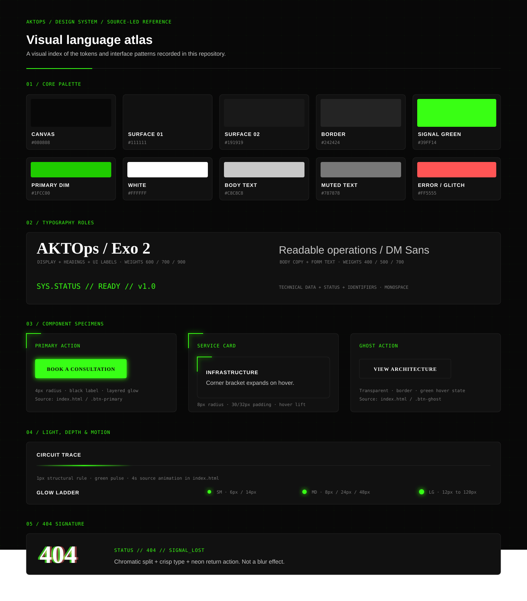

# AKTOps design token reference

**Evidence basis:** repository source inspection of `DESIGN.md`, `index.html`, `404.html`, `admin/index.html`, and the existing `docs/design-system.md`.

**Status:** reference catalogue. It documents the existing design contract and calls out where the written specification and current implementation differ. It does not silently change production CSS.

## Visual overview

The [visual atlas SVG](visual-atlas.svg) is a repository-local, zoomable reference. It presents source-defined colour swatches, type roles, component specimens, glow layers, circuit traces and the 404 chromatic treatment.

## 1. Colour tokens

| Token | Value | Semantic role | Evidence |
|---|---|---|---|
| `color.canvas` | `#080808` | Page canvas / on-primary text | DESIGN.md, index.html, 404.html |
| `color.surface.1` | `#111111` | Cards, modal and primary panels | DESIGN.md, index.html |
| `color.surface.2` | `#191919` | Elevated surfaces, tooltip and status track | DESIGN.md, index.html |
| `color.surface.section` | `#0C0C0C` | Alternate full-width section background in the landing page | index.html |
| Logo halo | `rgba(80,200,70,0.35)` | Asset-specific green drop shadow; not the core signal token | index.html |
| `color.border` | `#242424` | Borders, dividers and input outlines | DESIGN.md, index.html |
| `color.signal` | `#39FF14` | Primary action, active state, circuit pulse | DESIGN.md, index.html, 404.html |
| `color.signal.dim` | `#1FCC00` | Defined pressed/active variant; not consistently used in current page CSS | DESIGN.md |
| `color.signal.tint` | `rgba(57,255,20,0.12)` | Subtle tinted interaction surface | DESIGN.md |
| `color.text.primary` | `#FFFFFF` | High-emphasis headings and controls | DESIGN.md, index.html |
| `color.text.body` | `#C8C8C8` | Body copy and supporting content | DESIGN.md, index.html, 404.html |
| `color.text.muted` | `#787878` | Supporting copy and labels | DESIGN.md, index.html, 404.html |
| `color.text.subdued` | `#3A3A3A` | Metadata and placeholders | DESIGN.md, index.html, 404.html |
| `color.signal.error` | `#FF5555` | 404 red chromatic offset | 404.html |
| Ambient green fields | `rgba(57,255,20,0.025–0.11)` | Circuit grid and radial illumination opacity values; effects, not standalone colour tokens | index.html |

### Colour usage

- Green is the signal colour. Use it to communicate action, focus, state or a meaningful brand moment.
- The green CTA fill is an intentional exception to the prose in `DESIGN.md` that says never to use green as a background. The live `.btn-primary` and 404 `.btn` both use a green fill with near-black text.
- The 404 red is a chromatic/glitch layer, not a general danger palette. Do not reuse it as a generic validation colour without a separate decision.
- `#000000` is not the canvas token. Use `#080808`.

## 2. Typography tokens

| Role | Family | Source-defined scale | Current page evidence |
|---|---|---|---|
| Display | Exo 2 | 4.5rem / 900 / 1.0 | 404 uses 900 with responsive clamp |
| H1 | Exo 2 | 3rem / 700 / 1.1 | Section heading scale is responsive/custom |
| H2 | Exo 2 | 2.25rem / 700 / 1.15 | `.section-h2` uses 42px / 700 / 1.12 |
| H3 | Exo 2 | 1.5rem / 600 / 1.25 | Inline section headings use 19px / 600 |
| Body large | DM Sans | 1.125rem / 400 / 1.6 | `.section-p` uses 18px / 1.6 |
| Body medium | DM Sans | 1rem / 400 / 1.65 | General body role |
| Body small | DM Sans | 0.875rem / 400 / 1.6 | Supporting copy |
| UI label | Exo 2 | 0.75rem / 700 / 0.1em | Navigation/buttons commonly 11.5px |
| Operational | JetBrains Mono | 0.875rem / 400 / 1.5 | Status, metadata and technical labels |

Font loading is currently via Google Fonts in the HTML. Do not assume local font files are vendored. Preserve the family roles: Exo 2 for display/UI labels, DM Sans for prose and fields, JetBrains Mono for system-like data.

Brand lockup rule in `DESIGN.md`: ANDIE in white, KOBBIE in signal green with restrained glow, TECH. in white. The final period is part of the mark.

## 3. Shape, spacing and layout

| Token / rule | Value | Interpretation |
|---|---:|---|
| Radius small | 2px | Minor geometry |
| Radius control | 4px | Buttons, inputs and compact controls |
| Radius container | 8px | Cards, panels and overlays |
| Radius full | 0px | The source spec explicitly defines this as square, not pill |
| Spacing xs / sm | 4px / 8px | Tight control spacing |
| Spacing md / lg | 16px / 24px | Standard component spacing |
| Spacing xl / 2xl | 48px / 96px | Section and layout rhythm |
| Grid | 12 columns | Conceptual layout grid in DESIGN.md |
| Content width | 1280px | Design target; current landing page uses 1180px section wrappers |
| Body line length | ~680px / 72 chars | Reading measure target |
| Navigation | 64px | Fixed header height |
| Desktop section rhythm | 96px | Top/bottom section spacing target |
| Mobile section rhythm | 64px | Top/bottom section spacing target |

The current page uses multiple explicit paddings and breakpoints. Treat the values above as design-system guidance, not proof that every section currently follows a uniform spacing scale.

## 4. Elevation and optical effects

| Token | Source definition | Intended use |
|---|---|---|
| Glow SM | `0 0 6px #39FF14, 0 0 14px rgba(57,255,20,0.55)` | Small signal halo |
| Glow MD | `0 0 8px #39FF14, 0 0 24px rgba(57,255,20,0.50), 0 0 48px rgba(57,255,20,0.25)` | Primary action / medium diffusion |
| Glow LG | `0 0 12px #39FF14, 0 0 32px rgba(57,255,20,0.55), 0 0 72px rgba(57,255,20,0.28), 0 0 120px rgba(57,255,20,0.12)` | High-emphasis CTA / focus emphasis |

Other observed effects:

- Navigation: translucent `rgba(8,8,8,0.85)` with 12px backdrop blur.
- Booking overlay: dark translucent scrim with 6px backdrop blur.
- Tooltip: elevated `#191919` panel, green-tinted border and dark shadow.
- Cards: top-left 38px corner bracket that expands across the card on hover; hover also raises the card by 2px.
- Circuit rule: 1px border-colour line with a moving green gradient pulse. The current keyframe duration is 4 seconds.
- 404: white display text with green/red offset pseudo-element copies using `mix-blend-mode: screen`. It is a chromatic split, not backdrop blur.

## 5. Component inventory

| Component / pattern | Current implementation | Key states / details |
|---|---|---|
| Fixed navigation | `nav`, `.nav-logo`, `.nav-links`, `.nav-link` | 64px, blurred dark surface, green hover |
| Primary button | `.btn-primary`, `.btn-primary-lg`, `.btn-sign-in`, 404 `.btn` | Green fill, black text, glow, slight hover lift |
| Ghost button | `.btn-ghost`, `.btn-ghost-lg` | Transparent, bordered, green hover/focus treatment |
| Service / outcome card | `.card`, `.card-outcome` | Corner bracket, border glow, 2px hover lift |
| Perk card | `.perk-card` | Horizontal flex layout, green dot, subtle border response |
| Glossary term | `.term` | Dashed green underline, help cursor, green hover |
| Tooltip | `#tip-box`, `.tip-inner`, `.tip-title`, `.tip-body`, `.tip-arrow` | Fixed floating panel, dark elevated surface |
| Booking modal | `#book-overlay`, `.book-modal` | Scrim blur, responsive scroll, corner accent |
| Form controls | `.form-label`, `.form-input` | Dark field, 4px radius, green focus border/glow |
| Countdown | `.countdown-unit`, `.countdown-num`, `.countdown-label` | Dark tiles, luminous green numerals |
| Status indicator | `.status-bar`, `.status-shimmer` | 3px track, animated green shimmer |
| Circuit divider | `.circuit-rule`, `.circuit-line`, `.circuit-pulse` | 1px divider with moving green trace |
| 404 state | `.code`, `.glitch`, `.btn`, `.meta` | Status label, chromatic split, return action |
| Splash / intro | `#spx`, `#spx-grid`, `#spx-radial`, `#spx-presents`, `#spx-powered` | Full-screen intro, circuit grid, radial field, staged wordmark and powered-by lockup |
| Brand wordmark | `#spx-ak`, `#spx-cloud`, `#spx-pre-word` | Exo 2 wordmark, green/white split, typewriter caption |
| Hero | `#top`, `#hero`, `#hero-logo-tap` | Centered hero, oversized AKTOps wordmark, radial highlight and primary action |
| Section bands | `#credits`, `#stories` | Alternate `#0C0C0C` bands with top/bottom border |
| Partner/status tiles | Inline footer panels, `.status-bar`, `.status-shimmer` | Three compact verification/status panels with animated progress shimmer |
| CMS loading fallback | `.cms-loading` in `admin/index.html` | Dark bordered panel; currently uses system font |

## 6. Motion and timing

| Animation | Current source behaviour | Reduced-motion handling |
|---|---|---|
| `akTrace` | Circuit pulse traverses line over 4s | Global reduced-motion media query disables animations |
| `akBlink` | 50% on/off cursor-like blink | Same global query |
| `akNode` | Node opacity/scale pulse | Same global query |
| `akShimmer` | 1.8s / 2.3s shimmer variants | Same global query |
| `akFade` | 8px upward entrance with opacity | Same global query |
| `akFadeIn` | Opacity entrance | Same global query |
| `spxAKIn` | 1.4s scale/opacity wordmark entrance after 0.3s delay | Same global query |
| `spxCloudIn` | 1.2s horizontal/opacity entrance after 1.6s delay | Same global query |
| `spxType` / `spxCursor` / `spxCursorOff` | Typewriter reveal and timed cursor blink | Same global query |
| `spxPoweredIn` | 1.2s powered-by reveal after 5s delay | Same global query |
| `spxRadialPulse` | 2.4s radial illumination pulse, delayed and alternating | Same global query |
| `spxExit` | Splash fade-out keyframe | Same global query |
| Card hover | Border/glow expansion and 2px lift | Transition disabled under reduced motion |

The implementation has a broad `prefers-reduced-motion: reduce` override in `index.html`. Keep motion non-essential and do not remove this fallback.

## 7. Responsive implementation notes

- Navigation padding reduces from 40px to 20px at the 768px breakpoint.
- The main page includes a 600px breakpoint for booking modal layout and a 768px breakpoint for general layout.
- The 404 uses a fluid heading size: `clamp(48px, 12vw, 96px)`.
- Keep touch interactions usable; the glossary must not depend exclusively on hover.
- Validate at narrow mobile, tablet and desktop widths, including long copy and keyboard focus.

## 8. Source conflicts and design debt

The repository contains both a formal `DESIGN.md` and a live implementation. They are not perfectly aligned:

1. `DESIGN.md` specifies 1280px maximum content width; `index.html` currently uses 1180px for `.section-inner` and `.circuit-rule`.
2. `DESIGN.md` specifies 32px service-card padding; `.card` currently uses 30px and `.card-outcome` uses 32px.
3. `DESIGN.md` says glow should be reserved for interactive/key brand elements, but current section eyebrow and countdown text also glow.
4. `DESIGN.md` says green should never be a background fill, but the primary CTA and 404 return button are green filled. The working UI is the stronger evidence for those existing components.
5. `DESIGN.md` says traditional box shadows are not used, but current card hover, tooltip and button styles use box shadows. These are functional optical treatments, not a consistent absence of shadows.
6. The formal spec describes a 48px circuit background grid at 3% green opacity. The live splash uses 3%; the persistent page background uses 2.5%. The landing hero and splash also use radial green gradients, despite the formal spec's general prohibition on decorative background gradients. Preserve these as existing exceptions unless a deliberate visual decision changes them.
7. The formal spec describes the service-card corner bracket as expanding from 40×40px to 80×80px. The live CSS starts at 38×38px and expands the pseudo-element to the full card dimensions plus 2px.
8. Logo assets use a separate `rgba(80,200,70,0.35–0.42)` drop-shadow treatment. Do not silently replace it with the signal-green token.
9. The root `DESIGN.md` and `uploads/DESIGN.md` are near-duplicates with different names/descriptions. Treat the root file as the canonical design contract; do not edit the CMS upload copy as if it were a production token source.

Resolve these contradictions deliberately in a future design decision record. Do not change visual behaviour merely to make code match a prose specification.

## 9. Pixel and colour sampling protocol

The atlas uses exact hex/RGBA values declared in the repository source. It is a source-token swatch board, not a claim that average RGB values were extracted from screenshot pixels.

For actual raster sampling, use the committed source images as separate evidence:

1. Confirm the real image format from its file signature, not its extension.
2. Sample flat, opaque regions away from antialiased edges, text, glow and compression artefacts.
3. Record the image path, SHA-256, dimensions, colour profile, sample coordinates, RGB/HEX and alpha.
4. For gradients or glows, record a region distribution or multiple coordinates; do not collapse a luminous field into one misleading average.
5. Compare raster samples with CSS literals and mark the result as exact, approximate or unexplained.
6. Never promote a sampled pixel to a design token until it is confirmed as intentional.

The current `screenshots/hero.png` and `screenshots/tip.png` payloads are JPEG-encoded despite their `.png` names. Treat this as an asset-format hygiene issue; do not assume PNG lossless sampling or rename the files without updating all references and verifying the build.

## 10. Related references

- [Core design system](../design-system.md)
- [Visual atlas](visual-atlas.svg)
- [Pixel sampling protocol](pixel-sampling.md)
- [Google Stitch workflow](stitch-workflow.md)
- [OpenCode design skill](../../.opencode/skills/aktops-design/SKILL.md)
- [Root design contract](../../DESIGN.md)
